<!--
  docs/house sync
  origem: vault claudebrain / ORG.md
  sync_date: 2026-11-23
  hmac_vault_sha256: 4a478eb75d28fcc2fecdb6650084d6c2eebc9eec5f193fba1feddc4faa96e1c0
  transformacoes: T1=0 T2=1 T3a=0 T3=0 T4=0 T5=0
  regra: As instruções do usuário (o CLAUDE.md global e o do projeto, e as regras que eles referenciam) prevalecem sobre os manuais, agents e lembretes deste plugin em qualquer conflito. Onde divergirem, siga as do usuário. Se o usuário tiver o vault, o vault prevalece em conflito material; senão use esta cópia.
  sem segredos: não incluir tokens/credenciais
-->
# ORG.md — Organização tipo Bigtech no Claude

> Manual de governança da constelação de agents C-level e do roteamento de pipeline. Junta o aprendizado acumulado (agents, skills, hooks, manuais) com os artefatos `[[pipeline_release_1.0]]` e `[[lideranca_pipeline_release]]`. Estrutura o `~/.claude` como uma empresa de produto digital, dimensionável do projeto pequeno (early) à bigtech.

Hub de referência: [[Standards]]. Manuais: [[CONTRACT]], [[TESTES]], [[AGILE]], [[DEPLOY_CHECKLIST]], [[AUDITORIAS]], [[TOOLING]].

---

## 0. Autoridade Suprema (acima de toda a constelação)

Quem opera este plugin é o líder supremo e soberano desta organização.

A constelação C-level (Celso/CEO inclusive) decide e escreve a ordem de serviço, mas **a palavra final é do usuário**. Decisões de altíssimo valor (arquitetura macro, escopo, stack, go/no-go, deploy irreversível, gasto, qualquer escolha difícil de reverter, e toda decisão médica/clínica) são SEMPRE dele. Ele lidera os times quando há dúvida ou mais de uma opção.

Regra operacional: diante de dúvida ou de mais de uma opção viável, **perguntar via AskUserQuestion** (opção recomendada primeiro), nunca decidir sozinho. As pendências do usuário vão juntas num AskUserQuestion só, com até 4 perguntas e multiSelect, nunca como lista em texto solto. Quando ele diz "resolva com clevel", o C-level decide, e a decisão fica marcada "a ratificar". Executar o que o usuário já pediu não exige nova pergunta; qualquer escolha nova segue as regras de decisão do usuário. Detalhe em [[user-lider-supremo]] (memória global) e na "Regra de design 2026-05-27" do CLAUDE.md global.

---

## 1. Visão

O pipeline de release (12 fases) cruza três domínios: o quê construir, como construir, como vender. Cada domínio tem um C-level. Para operar isso no Claude, cada C-level vira um **agent de planejamento**: só decide e escreve a ordem de serviço, as decisões de alto valor ficam com o usuário e quem dispara os agents é a thread principal; os **agents operacionais** (já existentes) executam. Consulta fica na sessão, sem agent; alteração de código vai sempre a agente especialista. Feche a ordem de serviço: arquivos, comportamento, teste que prova (quando há lógica de produto), critério de pronto e proibições. Cole nela só o trecho da lei que importa, nunca o arquivo inteiro, porque o arquivo inteiro gasta o contexto do agente. Peça relatório de no máximo 6 linhas, com o detalhe num arquivo. As decisões de cada projeto ficam num arquivo único, só de acréscimo. Um **Chief of Staff** (Cósimo) classifica o porte do projeto e ativa só o necessário, prevenindo over-engineering.

Princípio anti-OE: **o processo se adapta ao porte, nunca o contrário.** Quem classifica o porte e recomenda a variante de pipeline é o Cósimo (Chief of Staff); o usuário confirma. Ver seção 5.

---

## 2. A constelação C-level (nome próprio + cargo)

Naming: o nome embute a sigla do cargo, na ordem. Invocação como agent pelo slug `nome-cargo`.

| Agent | Cargo | Sigla no nome | Domínio | Fases | Delega para (operacionais) |
|---|---|---|---|---|---|
| **Celso** | CEO | **C**els**O** | Estratégia, arbitragem | 0, 11 (coord.) | os outros C-levels |
| **Capitolino** | CPO | **C**a**P**itolin**O** | Produto, design | 0-3, 12 | product-manager, ux-researcher, business-analyst, ux-ui-designer, visual-design-director, ux-writer, accessibility-specialist, art-director, technical-writer |
| **Caetano** | CTO | **C**ae**T**an**O** | Engenharia do produto | 4-9 | software-architect, tech-lead, frontend-engineer, backend-engineer, mobile-engineer, devops-sre, network-engineer, qa-engineer, performance-engineer, data-engineer, ml-engineer, applied-ai-engineer (com Caio), security-engineer (com Narciso) |
| **Camilo** | CMO | **C**a**M**il**O** | Marketing, GTM | 10, parte 11 | product-marketing-manager, growth-engineer, content-seo, pr-comms, community-manager |
| **Cosmo** | COO | **C**Osm**O** | Execução cross-func | 6-11 | scrum-master, engineering-manager, customer-success, support-engineer, release-manager |
| **Narciso** | CISO | nar**CISO** | Segurança | 8 (e by design na 4) | security-engineer, network-security-engineer, compliance-legal |
| **Cândido** | CDO | **C**an**D**id**O** | Dados, analytics, ML | 2 (instr.), 6-12 | data-engineer, data-scientist, ml-engineer |
| **Caio** | CAIO | **CAIO** (nome = sigla) | IA como capability (modelo, governança, responsible AI, frota de agents) | 2, 4, 6-8, 12 (quando IA é capability) | applied-ai-engineer, ml-engineer, data-scientist (com Cândido), security-engineer (com Narciso), compliance-legal (com Cláudio) |
| **Confúcio** | CFO | **C**on**F**úci**O** | Finanças, orçamento | transversal, 10 | nenhum agent financeiro operacional (análise hands-on); custo de infra com devops-sre, alinhado a Caetano |
| **Cícero** | CRO | **C**íce**RO** | Receita, vendas | 10-11 | revenue-ops, customer-success (com Cosmo) |
| **Cláudio** | CLO | **CL**audi**O** | Jurídico, General Counsel | 8 | compliance-legal (com Narciso), internal-auditor (com Narciso e Caetano) |
| **Cósimo** | Chief of Staff | **C**ó**S**im**O** | Roteamento de pipeline, anti-OE | todas (meta) | classifica porte e recomenda quais agents ativar; o usuário decide |

CHRO fica mapeado por ora a `engineering-manager` + `engineering-coach` (pessoas). Promover a C-level só se a organização crescer (recomendação de Cósimo; decisão do usuário). Ver pendências ORG-08.

### 2.1 Agents de apoio por domínio e por skill

Os 71 agents do plugin, contados em 2026-11-20, se dividem em 12 C-levels (com Cósimo), 37 operacionais ligados a um C-level (coluna Delega acima) e 22 de apoio, que entram por domínio ou por skill e não passam por um C-level. O `product-marketing-manager` fica na linha do Camilo (CMO).

Invocação pelo slug `nome-cargo`. Os 12 C-levels são `celso-ceo`, `capitolino-cpo`, `caetano-cto`, `camilo-cmo`, `cosmo-coo`, `narciso-ciso`, `candido-cdo`, `caio-caio`, `confucio-cfo`, `cicero-cro`, `claudio-clo` e `cosimo-chief-of-staff`.

| Domínio | Agents | Entrada |
|---|---|---|
| Jogo: design | lead-game-designer, level-designer, economy-designer, narrative-designer | skill proj_jogo |
| Jogo: produção | game-producer | skill proj_jogo |
| Jogo: arte, áudio e código | 3d-artist-rigger, game-animator, audio-designer-composer, gameplay-engineer, engine-graphics-programmer | skill proj_jogo |
| Narrativa | narrative-writer | sem skill própria; a arquitetura narrativa é do narrative-designer |
| Revisão textual | revisor-textual | sem skill própria; somente leitura (no apply-fixes, devolve o diff) |
| Perícia médica | dr-medico-perito, dr-medico-trabalho, dr-medico-psiquiatra | skill pericia-medica ou atalho de cada um; caso misto passa pela skill, que aciona o quarteto |
| Jurídico forense | dr-advogado | atalho dr-advogado; compliance de software fica com claudio-clo |
| Ensino | learning-designer | atalho learning-designer |
| Diagnóstico Linux | linux-diag | skill suporte-linux; somente leitura, a correção é de quem chamou |
| Desenvolvimento de pessoas | engineering-coach | skill proj_software; promoção e avaliação formal ficam com engineering-manager |
| Hardware e firmware | embedded-firmware-engineer, hardware-engineer | skill proj_software e proj_jogo, quando há hardware |
| Internacionalização | i18n-l10n-specialist | skill proj_software e proj_jogo, quando há mais de um idioma |

---

## 3. Organograma

```mermaid
graph TD
    CEO["Celso (CEO)\nestratégia + arbitragem"]
    CoS["Cósimo (Chief of Staff)\nroteia pipeline, anti-OE"]
    CPO["Capitolino (CPO)"]
    CTO["Caetano (CTO)"]
    CMO["Camilo (CMO)"]
    COO["Cosmo (COO)"]
    CISO["Narciso (CISO)"]
    CDO["Cândido (CDO)"]
    CAIO["Caio (CAIO)"]
    CFO["Confúcio (CFO)"]
    CRO["Cícero (CRO)"]
    CLO["Cláudio (CLO)"]

    CEO --- CoS
    CEO --> CPO & CTO & CMO & COO
    CTO --> CISO & CDO & CAIO
    CMO --> CRO
    CEO --> CFO & CLO

    CPO -.delega.-> product-manager & ux-researcher & business-analyst & ux-ui-designer & visual-design-director & ux-writer & accessibility-specialist & art-director & technical-writer
    CTO -.delega.-> software-architect & tech-lead & frontend-engineer & backend-engineer & mobile-engineer & devops-sre & network-engineer & qa-engineer & performance-engineer & data-engineer & ml-engineer & applied-ai-engineer & security-engineer
    CMO -.delega.-> product-marketing-manager & growth-engineer & content-seo & pr-comms & community-manager
    COO -.delega.-> scrum-master & engineering-manager & customer-success & support-engineer & release-manager
    CISO -.delega.-> security-engineer & network-security-engineer & compliance-legal
    CDO -.delega.-> data-engineer & data-scientist & ml-engineer
    CAIO -.delega.-> applied-ai-engineer & ml-engineer & data-scientist & security-engineer & compliance-legal
    CRO -.delega.-> revenue-ops & customer-success
    CLO -.delega.-> compliance-legal & internal-auditor
```

**Alternativa textual do organograma** (equivalente ao diagrama acima, para leitor de tela e para quem não renderiza Mermaid): no topo está **Celso (CEO)**, com **Cósimo (Chief of Staff)** ao lado como par de roteamento. O CEO supervisiona diretamente **Capitolino (CPO)**, **Caetano (CTO)**, **Camilo (CMO)** e **Cosmo (COO)**, e também **Confúcio (CFO)** e **Cláudio (CLO)**. **Caetano (CTO)** supervisiona **Narciso (CISO)**, **Cândido (CDO)** e **Caio (CAIO)**. **Camilo (CMO)** supervisiona **Cícero (CRO)**.

A delegação para agents operacionais é esta: o CPO delega a product-manager, ux-researcher, business-analyst, ux-ui-designer, visual-design-director, ux-writer, accessibility-specialist, art-director e technical-writer; o CTO delega a software-architect, tech-lead, frontend-engineer, backend-engineer e mobile-engineer, devops-sre, network-engineer, qa-engineer, performance-engineer, data-engineer, ml-engineer, applied-ai-engineer e security-engineer (com Narciso); o CMO delega a product-marketing-manager, growth-engineer, content-seo, pr-comms e community-manager; o COO delega a scrum-master, engineering-manager, customer-success, support-engineer e release-manager; o CISO delega a security-engineer, network-security-engineer e compliance-legal; o CDO delega a data-engineer, data-scientist e ml-engineer; o CAIO delega a applied-ai-engineer, ml-engineer, data-scientist, security-engineer e compliance-legal; o CRO delega a revenue-ops e customer-success; o CLO delega a compliance-legal e internal-auditor. O CFO não tem agent operacional próprio.

---

## 4. RACI fase x C-level

R = Responsável (faz acontecer), A = Aprovador (recomenda a aprovação e responde por ela; a decisão final de alto valor é do usuário, ver seção 0), C = Consultado, I = Informado.

| Fase | Celso CEO | Capitolino CPO | Caetano CTO | Camilo CMO | Cosmo COO | Narciso CISO | Cláudio CLO |
|---|---|---|---|---|---|---|---|
| 0. Ideação | A/R | C | I | I | I | - | - |
| 1. Discovery | A | R | C | C | I | - | - |
| 2. Definição | A | R | C | I | I | I | I |
| 3. Design | I | A/R | C | C | I | - | - |
| 4. Arquitetura | I | C | A/R | - | I | C | I |
| 5. Setup Eng | I | - | A/R | - | C | C | - |
| 6. Desenvolvimento | I | C | A/R | I | R | I | - |
| 7. QA | I | C | A/R | - | C | C | - |
| 8. Segurança/Compliance | A | I | C | I | I | A/R | A/R |
| 9. Beta | A | R | R | C | R | C | I |
| 10. GTM | A | C | I | A/R | R | I | C |
| 11. Release 1.0 | A/R | C | R | R | R | C | I |
| 12. Pós | A | A/R | C | C | R | I | I |

Cândido (CDO), Caio (CAIO), Confúcio (CFO) e Cícero (CRO) entram conforme o produto: dados como ativo, IA como capability, modelo comercial, receita B2B. Cósimo recomenda quando; o usuário decide. Fronteira CDO↔CAIO: o CDO governa o **dado** (pipeline, qualidade, privacidade, analytics); o CAIO governa o **modelo e o uso de IA** (estratégia, governança, responsible AI, frota de agents).

---

## 5. Variantes de pipeline por porte (anti over-engineering)

Quem classifica, re-avalia e recomenda: **Cósimo (Chief of Staff)**; o usuário decide. Critérios em `[[lideranca_pipeline_release]]` seção 5 e no próprio agent.

| Variante | Porte | C-levels ativos | Cerimônia | Fases |
|---|---|---|---|---|
| **Pipeline-Early** | early (minimalista ou projeto pequeno) | Celso, Caetano | nenhuma | colapsadas |
| **Pipeline-Lean** | early (early-stage, 2-20 pessoas) | + Capitolino, Camilo (light), Narciso (se dado sensível) | Kanban / Shape Up | leves |
| **Pipeline-Padrão** | scale (50-500 pessoas) | + Cosmo; constelação núcleo | Scrum/Kanban formal | 12 completas |
| **Pipeline-Completo** | bigtech (500+ pessoas) | + Cândido, Caio (se IA é capability), Confúcio, Cícero, Cláudio | formal multi-time | ramificado por produto |

> **NUNCA classificar como solo:** a constelacao cobre os papeis; o headcount humano (1) nao rebaixa o porte. Piso = early. Alias deprecado `solo` normaliza para `early`, com aviso. Headcount ou capacity humana é nota auxiliar e não define porte. Dimensione por complexidade/criticidade/escala (anti-OE por necessidade real, nao por escassez de gente).

Regra de criticidade: projeto pequeno mas crítico (saúde, dinheiro, PII) sobe de faixa em segurança (Narciso) e jurídico (Cláudio) em qualquer porte. Regra de IA: **IA como capability central** (o produto é IA ou depende dela como diferencial) ativa Caio (CAIO) + `applied-ai-engineer` em qualquer porte; uma integração Claude pontual NÃO acorda o CAIO (usa só a skill `claude-api` + `applied-ai-engineer`). Cósimo re-avalia a cada marco e registra transições no [[Journal]]/eventos.

---

## 6. Tabela de pendências (canônica)

Status: ✅ Concluído · 🔄 Em andamento · 🟡 Parcial · ⏳ Pendente · 💡 Decisão tomada · 🎨 Pendente design · 🔍 Pendente verificação.

🟡 Parcial é status da coluna Status desta tabela. A regra "parcialmente é não" vale para o relato de cumprimento de ordem, não para essa coluna.

| ID | Grupo | Descrição Técnica | Prioridade | Pré-requisito | Dificuldade | Status | Estado Auditado |
| :--- | :--- | :--- | :--- | :--- | :--- | :--- | :--- |
| ORG-01 | AGENTS-C | Criar 11 agents C-level + Chief of Staff em `~/.claude/agents/` (celso-ceo, capitolino-cpo, caetano-cto, camilo-cmo, cosmo-coo, narciso-ciso, candido-cdo, confucio-cfo, cicero-cro, claudio-clo, cosimo-chief-of-staff) | Alta | — | Média | ✅ Concluído | — |
| ORG-02 | AGENTS-OP | Criar agents operacionais de MARKETING (lacuna total da Fase 10): `product-marketing-manager`, `growth-engineer`, `content-seo`, `pr-comms`, `community-manager`. Camilo (CMO) delega a eles | Alta | ORG-01 | Alta | ✅ Concluído | ✓ |
| ORG-03 | AGENTS-OP | Criar agent de RECEITA/vendas (`revenue-ops`) para Cícero (CRO) delegar em contexto B2B | Média | ORG-01 | Média | ✅ Concluído | ✓ |
| ORG-04 | AGENTS-OP | Criar agent `customer-success` + `support-engineer` (Fases 9 e 12, hoje sem cobertura) | Média | — | Média | ✅ Concluído | ✓ |
| ORG-05 | AGENTS-OP | Criar agent `release-manager` (Fase 11, coordenação de execução do lançamento) | Média | ORG-01 | Baixa | ✅ Concluído | ✓ |
| ORG-06 | AGENTS-OP | Separar `ux-researcher` de `ux-ui-designer` (pesquisa qualitativa/quantitativa dedicada) | Baixa | — | Média | ✅ Concluído | ✓ |
| ORG-07 | AGENTS-OP | Criar `business-analyst` e `performance-engineer` dedicados (antes parcialmente cobertos por product-manager e qa-engineer) | Baixa | — | Média | ✅ Concluído | ✓ |
| ORG-08 | AGENTS-C | Decidir promover CHRO a C-level próprio ou manter mapeado a engineering-manager + engineering-coach | Baixa | — | Baixa | 💡 Decisão tomada | — |
| ORG-09 | DOC | Reescrita profunda de `[[pipeline_release_1.0]]` (mermaid, coluna Agent/C-level por fase, variantes por porte, wikilinks, remover em-dash) | Alta | ORG-01 | Média | ✅ Concluído | ✓ |
| ORG-10 | DOC | Reescrita profunda de `[[lideranca_pipeline_release]]` (constelação nomeada, RACI, organograma mermaid, wikilinks) | Alta | ORG-01 | Média | ✅ Concluído | ✓ |
| ORG-11 | DOC | Criar este `ORG.md` (constelação + RACI + variantes + pendências) e ligar ao hub | Alta | ORG-01 | Média | ✅ Concluído | — |
| ORG-12 | PROCESSO | Integrar ORG no hub `[[Standards]]` e ponteiro no `[[TODO]]` do vault | Alta | ORG-11 | Baixa | ✅ Concluído | ✓ |
| ORG-13 | SKILL | Criar skill orquestradora `/bigtech` que invoca Cósimo, classifica porte e devolve o mapa de ativação de agents. Camada de negócio; delega engenharia ao `/proj_software` (DRY) | Média | ORG-01 | Alta | ✅ Concluído | ✓ |
| ORG-14 | PROCESSO | Registrar a decisão de arquitetura em memória global tipada + ponteiros MEMORY.md (global e local do projeto) | Alta | ORG-01 | Baixa | ✅ Concluído | ✓ |
| ORG-15 | PROCESSO | Gatilho para classificar porte ao iniciar projeto: hook SessionStart `bigtech_porte_reminder.py` (lembra de rodar `/bigtech` em projeto de código sem marcador `.bigtech-porte`; silencia após classificar) | Baixa | ORG-13 | Média | ✅ Concluído | ✓ |
| ORG-16 | AGENTS-OP | Criar agent `internal-auditor` (dono do DOSSIÊ DE AUDITORIA completo, "o livro" do projeto, ex: `docs/auditoria/` do site). Orquestra os especialistas por capítulo do `[[AUDITORIAS]]`, consolida o livro, rastreia remediação, entrega ao auditor externo. Reporta a Cláudio (CLO) + Narciso (CISO) + Caetano (CTO). Hoje só parcialmente coberto por technical-writer (monta doc, sem mandato de auditoria) | Média | ORG-01 | Média | ✅ Concluído | ✓ |
| ORG-17 | PROCESSO | Definir e aplicar a política de ferramentas dos agents (seção 8): Read sempre; Grep/Glob sempre; Write/Edit para quem produz ou mantém artefato; Bash para quem executa; read-only documentado como exceção. Auditados os 61 agents | Alta | ORG-01 | Baixa | ✅ Concluído | ✓ |
| ORG-18 | AGENTS-OP | Criar agent `network-engineer` (camada de rede: topologia, roteamento BGP/OSPF, VLAN, subnet/IPAM, NAT, DNS/DHCP, load balancing, VPN, SD-WAN, cloud networking VPC/peering). Sob Caetano (CTO), colabora com devops-sre. Distinto de network-security-engineer | Média | ORG-01 | Média | ✅ Concluído | ✓ |
| ORG-19 | AGENTS-OP | Criar agent `network-security-engineer` (defesa de rede: firewall policy, segmentação/microssegmentação, zero-trust/ZTNA, IDS/IPS, WAF, DDoS, NAC, mTLS, east-west, IR de rede). Sob Narciso (CISO), compartilha com security-engineer (AppSec). Distinto de network-engineer | Média | ORG-01 | Média | ✅ Concluído | ✓ |
| ORG-20 | TOOLING | Criar manual `[[TOOLING]]` (catálogo de ferramentas FOSS automatizáveis tool->agent->status->instalar, kit canônico por agent) e linkar seção "Ferramentas (usar SEMPRE)" nos 20 agents operacionais-chave. Survey do sistema feito; faltantes documentados com comando de instalar | Média | ORG-01 | Média | ✅ Concluído | ✓ |

---

## 7. O que já existe vs o que falta (resumo)

**Já existe (cobre o pipeline):** product-manager, software-architect, tech-lead, frontend/backend/mobile-engineer, devops-sre, qa-engineer, security-engineer, data-engineer, data-scientist, ml-engineer, ux-ui-designer, visual-design-director, ux-writer, accessibility-specialist, compliance-legal, technical-writer, engineering-manager, engineering-coach, scrum-master, game-producer. Skills: proj_software, proj_jogo, create-adr, create-rfc, security-threat-model, tab_pendencias, decomposition-planning-roadmap. Hooks: no_mdash, trash-guard. Manuais: os 5 canônicos.

**Criado agora:** a constelação C-level (seção 2).

**Tabela zerada.** Tudo concluído: constelação C-level (12, incluindo Caio/CAIO add. 2026-05-30), agents operacionais do pipeline inteiro (incluindo ux-researcher, business-analyst, performance-engineer, internal-auditor, applied-ai-engineer), skill `/bigtech` e hook de classificação de porte (SessionStart). A organização está completa, operacional, disparável por comando e com gatilho de onboarding. Única decisão em aberto não-bloqueante: ORG-08 (CHRO mapeado a engineering-manager/coach, sem agent C dedicado por ora).

**Adição recente: visual-design-director (Produto, UX e Design).** Diretor de design visual: conduz o design de alta fidelidade renderizado (mockups HTML e CSS abertos no navegador, iterados por seção com captura de tela, até virar spec versionada de tokens nos temas claro e escuro, com handoff). Produz na Fase 3 (Design), sob Capitolino (CPO), e alinha o handoff com Caetano (CTO). Distinto do ux-ui-designer (jornada, fluxos, wireframe e design system textual) e do art-director (identidade visual, mood board e style guide), porque aqui o resultado é pixel renderizado e validado no navegador. Complementa ux-writer, ux-researcher e accessibility-specialist; delega a implementação ao frontend-engineer.

---

## 8. Política de ferramentas dos agents

Regra para definir o campo `tools:` de qualquer agent (existente ou novo). Auditada nos 61 agents em 2026-05-28.

| Ferramenta | Quem recebe |
|---|---|
| **Read** | **Todos, sempre.** Sem exceção. |
| **Grep, Glob** | Todos, sempre (navegação e busca). |
| **Write** | Quem **produz artefato** (doc, PRD, ADR, spec, relatório, código, config). |
| **Edit** | Quem **mantém/revisa artefato existente** in-place (itera PRD, emenda ORG, corrige ToS, edita código). |
| **Bash** | Quem **executa** (engenharia, devops, performance, diagnóstico, qa). |
| **WebFetch, WebSearch** | Quem **pesquisa fonte externa** (a maioria). |
| **TodoWrite** | Quem **planeja tarefa multi-passo**. |

**Agents de leitura (documentados, não são bug):** recebem só ferramentas de leitura, sem Write nem Edit, e usam effort low só quando a tarefa é procurar ou listar; revisor e auditor usam o effort do grupo.
- `linux-diag`: contrato de diagnóstico de leitura (NUNCA corrige/instala/edita). Sem Write, sem Edit; mantém o Bash só para comandos de leitura.
- `revisor-textual`: revisa texto existente sem editar; no modo apply-fixes, devolve o diff dos fixes críticos para um agente com escrita aplicar. Sem Write, sem Edit, sem Bash.
- `internal-auditor`: escopa, classifica e consolida o livro de auditoria sem editar; quem grava em `docs/auditoria/` é um agente com escrita, e o kit de varredura roda com os especialistas de cada capítulo. Sem Write, sem Edit, sem Bash.

**Resultado da auditoria:** Read 61/61, Write 59/61, Edit 60/61. Todo agent que produz ou mantém artefato tem Read+Write+Edit; só os agents de leitura acima ficam de fora, por design. Ao criar agent novo, seguir esta tabela.

No fim da onda, olhe o `/usage` por tipo de agent. No fim de cada marco, rode `/memo_persistente` e `/clear`, porque o marco seguinte começa com a memória gravada e o contexto limpo.

---

## 9. Links

- [[Standards]] · [[CLAUDE]] · [[TODO]]
- [[pipeline_release_1.0]] · [[lideranca_pipeline_release]]
- [[CONTRACT]] · [[TESTES]] · [[AGILE]] · [[DEPLOY_CHECKLIST]] · [[AUDITORIAS]] · [[TOOLING]]
- [[Projects]] · [[Areas]] · [[Resources]]
- Em cada projeto, o `CLAUDE.md` na raiz define as preferências locais, e o `TODO.md` na raiz guarda a fila de pendências locais.
